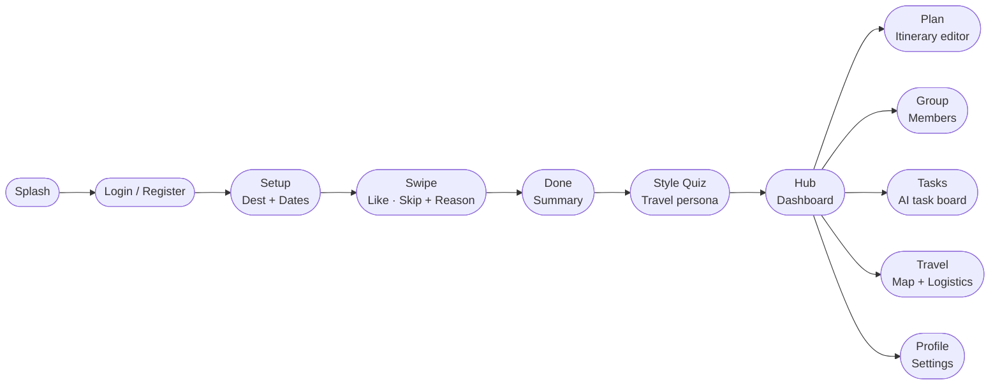

# jet2holiday — Project Architecture

## Project Overview

**jet2holiday** is a collaborative travel planning web app built with React + Vite. Inspired by swipe-style interfaces (think dating apps), it lets groups plan trips together by swiping on places and activities — but crucially, it also captures the *reasoning* behind each preference, enabling genuine group consensus instead of majority-rules domination.

**Key differentiator:** Instead of just aggregating a group's "yes/no" votes, jet2holiday surfaces the *why* behind every swipe, making negotiation and itinerary compromise transparent and fair.

---

## Tech Stack

| Layer | Technology |
|---|---|
| Frontend | React 19 + Vite 8 |
| Routing | React Router DOM v7 |
| Animation | Framer Motion 13 |
| Drag & Drop | @dnd-kit/react |
| Maps | Mapbox GL / react-map-gl |
| Icons | Phosphor React |
| Utilities | clsx |
| Auth & BaaS | Supabase JS v2 |
| Backend (Edge) | Supabase Edge Functions (Deno/TypeScript) |
| AI | Google Gemini 2.0 Flash (via Edge Function) |
| Places Search | SerpApi (Google Maps Autocomplete engine) |
| Static Maps | Google Maps Static API |
| Linting | oxlint |

---

## Architecture Diagram

```mermaid
graph TD
    subgraph Browser["Browser (React SPA)"]
        direction TB

        main["main.jsx\n(Entry Point)"]
        App["App.jsx / Shell\n(Router + Layout)"]
        
        subgraph State["State Layer"]
            AppState["useAppState.js\n(localStorage-backed\nglobal state hook)"]
            AuthCtx["AuthContext.jsx\n(Supabase Auth\nsession + profile)"]
        end

        subgraph Pages["Pages (src/pages/)"]
            direction LR
            Splash["SplashScreen\n(Landing)"]
            Auth["LoginScreen\nRegisterScreen\nForgotPasswordScreen\nResetPasswordScreen"]
            Setup["SetupScreen\n(Trip config:\ndest, dates, leader)"]
            Swipe["SwipeScreen\n(Core swipe UX)"]
            Done["DoneScreen\n(Swipe summary)"]
            Style["StyleScreen\n(Travel style quiz)"]
            Hub["HubScreen\n(Trip dashboard)"]
            Plan["PlanScreen\n(Shared group plan:\nrouted days + times)"]
            Group["GroupScreen\n(Group members)"]
            Tasks["TasksScreen\n(Task board)"]
            Travel["TravelScreen\n(In-trip view +\nMapbox map)"]
            TravelSearch["TravelSearchScreen\n(Flights / stays /\nrentals search)"]
            Profile["ProfileScreen\n(User settings)"]
        end

        subgraph Components["Shared Components (src/components/)"]
            AppHeader
            TabBar
            SwipeCard
            RequireAuth
            InfiniteSpiral["InfiniteSpiral\n(Animated history)"]
            LineSidebar["LineSidebar\n(Plan timeline)"]
            PreferenceForm
            ReasonChips
            StyleCard
            BottomSheet
            ProgressBar
        end

        subgraph Services["Services (src/services/)"]
            PlacesSvc["placesAutocomplete.js\n(Proxy call)"]
            MapboxSvc["mapbox.js\n(Directions +\nOptimization API)"]
            TaskAgentSvc["taskAgent.js\n(AI task parser)"]
            TravelSearchSvc["travelSearch.js\n(Flights / stays /\nrentals search)"]
            TripSvc["tripService.js\n(Trip persistence)"]
            TripGenSvc["generateTrip.js\n(Deck generation)"]
            PrefSvc["preference.js\n(Preference agent)"]
            GroupPlanSvc["groupPlan.js\n(Group plan pipeline:\nplanner → itinerary →\nrouting → schedule)"]
        end

        subgraph Lib["Lib (src/lib/)"]
            SupabaseClient["supabase.js\n(Supabase client)"]
            Scheduler["scheduler.js\n(Deterministic clock\nfrom Mapbox legs)"]
        end

        subgraph Data["Static Data (src/data/)"]
            CardsData["cards.js\n(Place swipe cards)"]
            StylesData["styles.js\n(Travel style profiles)"]
            MembersData["members.js\n(Mock group members)"]
            TasksData["tasks.js\n(Mock task board)"]
            TravelData["travel.js\n(Flights, hotels, car rentals)"]
        end

        subgraph Utils["Utils (src/utils/)"]
            DateUtil["date.js\n(Date formatting)"]
        end
    end

    subgraph Supabase["Supabase Platform"]
        SupabaseAuth["Supabase Auth\n(Email/password)"]

        subgraph Database["PostgreSQL"]
            TripPlansDB["trip_plans\n(shared group plan:\ngroup_profile,\ncandidate_pois,\nvalidated_plan)"]
        end

        subgraph EdgeFunctions["Edge Functions (Deno)"]
            PlacesFn["places-autocomplete\n(SerpApi proxy +\nGoogle Static Maps)"]
            TaskFn["task-agent\n(Gemini AI:\nNL → task list)"]
            GroupPlannerFn["group-planner\n(Gemini: group profile\n→ candidate itinerary)"]
        end
    end

    subgraph ExternalAPIs["External APIs"]
        SerpApi["SerpApi\n(Google Maps Autocomplete)"]
        GoogleStaticMaps["Google Maps\nStatic API"]
        GeminiAPI["Google Gemini 2.0 Flash\n(generativelanguage API)"]
        MapboxAPI["Mapbox Directions API\n(Walking routes)"]
    end

    %% Entry
    main --> App
    App --> State
    App --> Pages

    %% State wiring
    AppState -- "persisted to" --> LocalStorage[(localStorage\ntripder-state-v1)]
    AuthCtx --> SupabaseClient
    SupabaseClient --> SupabaseAuth

    %% Pages use state
    Pages --> AppState
    Pages --> AuthCtx

    %% Pages use components
    Pages --> Components

    %% Pages use static data
    Swipe --> CardsData
    Style --> StylesData
    Setup --> MembersData
    Hub --> MembersData
    Hub --> TasksData
    Plan --> TravelData
    Hub --> TravelData
    Travel --> TravelData

    %% Pages use services
    Setup --> PlacesSvc
    Setup --> TripSvc
    Setup --> TripGenSvc
    Swipe --> PlacesSvc
    Swipe --> PrefSvc
    Swipe --> TripGenSvc
    Plan --> PlacesSvc
    Plan --> GroupPlanSvc
    Hub --> GroupPlanSvc
    Tasks --> TaskAgentSvc
    TravelSearch --> TravelSearchSvc
    Profile --> TripGenSvc

    %% Services
    TravelSearchSvc --> TravelData
    PlacesSvc -- "POST /places-autocomplete" --> PlacesFn
    TaskAgentSvc -- "POST /task-agent" --> TaskFn
    MapboxSvc --> MapboxAPI
    GroupPlanSvc -- "POST /group-planner" --> GroupPlannerFn
    GroupPlanSvc --> MapboxSvc
    GroupPlanSvc --> Scheduler
    GroupPlanSvc -- "read + write validated_plan\n(Realtime)" --> TripPlansDB
    GroupPlannerFn -- "service role:\nread summaries/swipes/deck,\nwrite plan" --> TripPlansDB

    %% Edge function → external
    PlacesFn --> SerpApi
    PlacesFn --> GoogleStaticMaps
    TaskFn --> GeminiAPI
    GroupPlannerFn --> GeminiAPI
```



---

## User Flow



---

## Directory Structure

```
WhereDo/
├── src/
│   ├── main.jsx                  # React entry point
│   ├── App.jsx                   # Shell: router, layout chrome, theme
│   ├── App.css / index.css       # Global styles + design tokens
│   │
│   ├── pages/                    # Screen-level route components (16 screens)
│   │   ├── SplashScreen.jsx      # Landing / onboarding
│   │   ├── LoginScreen.jsx
│   │   ├── RegisterScreen.jsx
│   │   ├── ForgotPasswordScreen.jsx
│   │   ├── ResetPasswordScreen.jsx
│   │   ├── SetupScreen.jsx       # Trip config (destination, dates, leader)
│   │   ├── SwipeScreen.jsx       # Core swipe + reason capture
│   │   ├── DoneScreen.jsx        # Post-swipe summary
│   │   ├── StyleScreen.jsx       # Travel style quiz
│   │   ├── HubScreen.jsx         # Trip dashboard / entry hub
│   │   ├── PlanScreen.jsx        # Shared group plan (routed days, times, map)
│   │   ├── GroupScreen.jsx       # Group member management
│   │   ├── TasksScreen.jsx       # AI-powered task board
│   │   ├── TravelScreen.jsx      # In-trip logistics + Mapbox map
│   │   ├── TravelSearchScreen.jsx# Flights / stays / rentals search
│   │   └── ProfileScreen.jsx     # User profile & auth settings
│   │
│   ├── components/               # Reusable UI components (11 JSX + 2 CSS)
│   │   ├── AppHeader.jsx         # Top nav bar
│   │   ├── TabBar.jsx            # Bottom tab navigation
│   │   ├── SwipeCard.jsx         # Individual swipeable card
│   │   ├── RequireAuth.jsx       # Auth route guard
│   │   ├── InfiniteSpiral.jsx    # Animated swipe history visualization
│   │   ├── InfiniteSpiral.css
│   │   ├── LineSidebar.jsx       # Timeline sidebar for plan view
│   │   ├── LineSidebar.css
│   │   ├── PreferenceForm.jsx    # Swipe reason capture form
│   │   ├── ReasonChips.jsx       # Tag chips for swipe reasons
│   │   ├── StyleCard.jsx         # Travel style option card
│   │   ├── BottomSheet.jsx       # Slide-up modal sheet
│   │   └── ProgressBar.jsx       # Progress indicator
│   │
│   ├── state/
│   │   └── useAppState.js        # Central app state hook (localStorage-backed)
│   │
│   ├── context/
│   │   ├── AuthContext.jsx       # Auth provider (Supabase session mgmt)
│   │   ├── auth-state.js         # React context object
│   │   └── useAuth.js            # useAuth consumer hook
│   │
│   ├── services/
│   │   ├── placesAutocomplete.js # Calls places-autocomplete edge function
│   │   ├── mapbox.js             # Directions + Optimization API
│   │   ├── taskAgent.js          # Calls task-agent edge function (Gemini AI)
│   │   ├── travelSearch.js       # Flights / stays / rentals search
│   │   ├── tripService.js        # Trip + deck persistence
│   │   ├── generateTrip.js       # Deck generation pipeline
│   │   ├── groupPlan.js          # Group plan pipeline (planner → route → schedule)
│   │   └── preference.js         # Preference agent
│   │
│   ├── lib/
│   │   ├── supabase.js           # Supabase client initialization
│   │   ├── scheduler.js          # Deterministic clock times from Mapbox legs
│   │   └── swipeDeck.js          # Deck progress from durable swipe rows
│   │
│   ├── data/                     # Static mock/seed data
│   │   ├── cards.js              # Swipe card content for Lisbon
│   │   ├── styles.js             # Travel style personas
│   │   ├── members.js            # Mock group member profiles
│   │   ├── tasks.js              # Mock task board
│   │   └── travel.js             # Mock flights, hotels, car rentals
│   │
│   └── utils/
│       └── date.js               # Date range formatting
│
├── scripts/                      # Repo guards, run via `npm run lint`
│   ├── check-colors.mjs          # brand-spec.md token discipline
│   ├── check-lint-warnings.mjs   # Fails on NEW oxlint warnings
│   ├── color-baseline.json       # Known pre-existing raw colour literals
│   └── lint-baseline.json        # Known pre-existing oxlint warnings
│
├── supabase/
│   └── functions/
│       ├── places-autocomplete/  # Deno edge fn: SerpApi proxy
│       │   └── index.ts
│       ├── task-agent/           # Deno edge fn: Gemini AI task parser
│       │   └── index.ts
│       ├── preference/           # Deno edge fn: per-member preference summary
│       │   └── index.ts
│       ├── generate-trip/        # Deno edge fn: deck discovery + enrichment
│       │   └── index.ts
│       └── group-planner/        # Deno edge fn: group profile → candidate itinerary
│           └── index.ts
│
├── public/                       # Static assets (images)
├── index.html                    # Vite entry HTML
├── vite.config.js
└── package.json
```

---

## Key Architectural Decisions

| Decision | Rationale |
|---|---|
| **localStorage for app state** | `useAppState.js` persists UI-facing trip state (counters, task board, deck identity) to `localStorage` under `tripder-state-v1`. Verdicts live in `public.swipes`, and deck progress is rebuilt from them, so local storage is a cache rather than the source of truth. |
| **DB-derived swipe progress** | The Swipe screen lists only cards with no verdict for this member (`getUserSwipes` + `lib/swipeDeck.js`), so refresh, invite links and new devices resume mid-deck or stay finished. `addedCards` is scoped to `cardsDeckId` so one trip's deck cannot leak into another, and invite links no longer reset progress. |
| **One verdict per member per place** | Partial unique indexes on `swipes` enforce one row per (member, trip/destination, place); the client looks the row up and updates it, latest verdict wins, so re-swiping can never duplicate or inflate group tallies. |
| **Supabase Auth only** | Supabase is used purely for authentication (email/password). No database tables — user data lives in Supabase Auth user metadata. |
| **Edge Functions as API proxies** | API secrets (SerpApi, Google Maps, Gemini) never reach the browser. All sensitive calls route through Supabase Deno edge functions. |
| **AI task extraction via Gemini** | The `task-agent` edge function sends natural-language trip messages to Gemini 2.0 Flash and gets back a structured JSON task list — enabling conversational task creation on the Tasks screen. |
| **Group plan lives in Supabase** | `trip_plans` holds one shared plan per trip. The `group-planner` edge function writes `group_profile` and `candidate_pois` under the service role; members read the row and may write only `validated_plan`, enforced by RLS plus a column-level grant. Realtime keeps every member on the same plan. |
| **LLM decides what, Mapbox decides when** | The Group Planner Agent produces priorities, conflicts and constraints from the preference summaries plus relevant swipe evidence (never the whole history). The Itinerary Agent assigns stops to days and is forbidden from emitting times. `scheduler.js` derives clock times deterministically from Mapbox travel legs and the recorded place durations; when Mapbox is unavailable it falls back to distance estimates rather than inventing numbers. |
| **No preset itineraries** | The old hardcoded `balanced` / `foodfirst` / `slower` plans and their route legs are gone. PlanScreen renders only the routed, timed group plan, with an Ideas backlog of unassigned candidates that can be added and re-routed. |
| **No global state library** | All state is managed via a single custom hook (`useAppState`) passed as a prop — no Redux, Zustand, or similar, keeping the MVP lean. |
